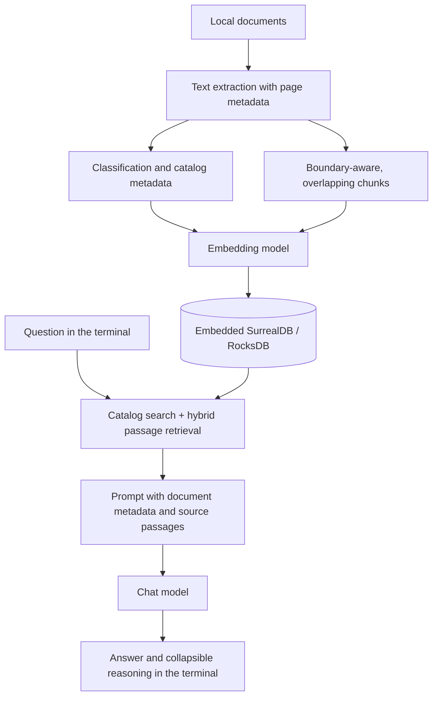

# Svarog

**A local-first AI assistant that turns documents into a searchable knowledge base, right in the terminal.**

Svarog is a Rust application for asking questions about your own reference material, project files, and notes. It combines language models with **retrieval-augmented generation (RAG)**: finding relevant source material before asking the model to answer.

The project implements the full document-to-answer pipeline: text extraction, document classification, metadata generation, chunking, embeddings, hybrid search, and a keyboard-driven terminal interface. Models are reached through **OpenAI-compatible endpoints**, so the same build works with a local [llama.cpp](https://github.com/ggml-org/llama.cpp) server or a hosted API such as Google's Gemini API.

**Status:** Early-stage prototype, version 0.1.0. Built for local, single-user use rather than production deployment.

[Features](#features) · [Architecture](#architecture) · [Getting started](#getting-started) · [Code guide](#code-guide) · [Limitations](#current-limitations)

## Features

- **Ask questions about local documents.** Import text-based PDFs, Markdown, Rust source, configuration files, and other supported text formats.
- **Search by meaning and keywords.** Combine embedding similarity with BM25 full-text search, then merge the results using Reciprocal Rank Fusion (RRF).
- **Build a document catalog automatically.** Generate titles, summaries, topics, identifiers, and entities, and classify documents as factual, project, or personal knowledge.
- **Keep source context visible.** Retrieved passages carry document titles and physical page numbers. The logs view exposes retrieved context and ranking scores; the answer prompt asks the model to cite sources when useful.
- **Reuse previously ingested knowledge.** Store the catalog, passages, embeddings, and ingestion hashes in an embedded database. Unchanged files skip classification and re-embedding on subsequent ingestion runs.
- **Choose local or hosted models.** Chat and embeddings use OpenAI-compatible endpoints, which can be configured separately. With local servers and local models, document processing does not require a hosted AI service or an API key.
- **Adapt to the embedding model.** Query and document instruction formats (for example, EmbeddingGemma's or nomic-embed's prefixes) are configurable.
- **Show model reasoning on demand.** Reasoning from thinking models is separated from the answer, shown as a collapsed block, and kept out of the conversation history.

### Example workflow

Add a technical manual and some project notes to the input directory, ingest them, then ask:

> What documents do you have about this component?
>
> According to the manual, what are the operating limits?
>
> What does the project documentation say about the storage design?

These are example prompts, not recorded results. Answer quality depends on the documents, retrieval results, and selected model.

## Architecture



### Engineering decisions

| Decision | Implementation and rationale |
| --- | --- |
| Separate document identity from evidence | The catalog describes what a document is about; chunks contain its source text. The grounded prompt explicitly distinguishes generated metadata from evidence for technical claims. |
| Fuse semantic and lexical retrieval | Vector and full-text searches run concurrently, returning up to 24 candidates each. RRF merges and deduplicates their rankings without requiring raw similarity and BM25 scores to share a scale. |
| Preserve source provenance | Text is chunked within each page, preferring paragraph, line, sentence, and word boundaries. Overlap carries nearby context, while document and page metadata remain attached to each chunk. |
| Avoid unnecessary model calls | SHA-256 content hashes combined with an ingestion-version marker identify unchanged sources. Deterministic document and chunk IDs support replacing a document's stored passages on re-ingestion. |
| Separate the UI from backend work | Typed requests and responses travel over Tokio channels. A separate task handles chat and ingestion, and CPU-bound PDF extraction runs on a blocking worker rather than the async executor. |
| Stay provider-agnostic | Rig's OpenAI dialects (`openai`, `llamacpp`, and others) cover hosted and local servers. Chat and embeddings each take their own endpoint, so a local embedding server can sit beside a hosted chat model. |
| Respect embedding rate limits | Passages are embedded in sequential batches. Rate-limited or temporarily unavailable responses are retried after the wait the provider requests. |
| Handle imperfect model output | Inline reasoning (`<thought>`, `<think>`) and separately returned reasoning are split from answers before display, classification, and metadata parsing. Metadata parsing tolerates surrounding commentary or Markdown fences. Invalid metadata falls back to a source-derived title; classification failures fall back to factual knowledge. |

For each question, the chat service supplies up to **three catalog matches** and **six source passages** to the model. If neither search yields context, it sends the original question without document augmentation.

### Technology stack

| Area | Technology |
| --- | --- |
| Language | Rust, 2024 edition |
| Async runtime and messaging | Tokio, Tokio channels |
| Terminal interface | Ratatui, Crossterm |
| Model integration | Rig (OpenAI-compatible Chat Completions and embeddings) |
| Persistence and search | Embedded SurrealDB with RocksDB, cosine similarity, BM25 |
| Document processing | pdf-extract, custom text chunking |
| Serialization and change detection | Serde, serde_json, SHA-256 |
| Configuration and errors | dotenvy, color-eyre |

Dependency versions are defined in [Cargo.toml](Cargo.toml).

## Getting started

### 1. Prerequisites

- A recent stable [Rust toolchain and Cargo](https://rustup.rs/) supporting the 2024 edition.
- An OpenAI-compatible model endpoint for chat and one for embeddings: local servers such as llama.cpp's `llama-server`, or a hosted API.
- Native build tools for the embedded database dependencies, including Clang/libclang:
  - **Ubuntu/Debian:** `sudo apt install build-essential clang libclang-dev`
  - **Windows:** the MSVC toolchain with Visual Studio's **Desktop development with C++** workload, plus the **C++ Clang Compiler for Windows** component (or a standalone LLVM install). Set `LIBCLANG_PATH` to the folder containing `libclang.dll`, for example `C:\Program Files\Microsoft Visual Studio\2022\<edition>\VC\Tools\Llvm\x64\bin`.

Clone this repository and open a terminal in its root directory. The first build can take a while because it includes native dependencies. No separate SurrealDB server is needed.

### 2. Prepare model endpoints

**Option A: local models with llama.cpp.** Run one `llama-server` for chat and one for embeddings, for example:

```sh
llama-server -m <chat-model>.gguf --port 8080
llama-server -m <embedding-model>.gguf --embedding --port 8081 -ub 2048
```

Embedding inputs must fit into one physical batch; a larger `-ub` avoids "input is too large" errors for long passages. Model files are downloaded once; inference then runs locally.

**Option B: Google's Gemini API.** Create an API key in [Google AI Studio](https://aistudio.google.com/apikey) and use the OpenAI-compatible endpoint. The free tier is rate-limited (embeddings: 100 passages per minute at the time of writing, so a 100-page PDF takes several minutes to ingest), and Google may use free-tier content to improve its products. Avoid sending private material on the free tier.

### 3. Configure the application

Create a local dotenv file named `.env` in the repository root and keep it out of version control. For llama.cpp, with nomic-embed as the embedding model:

```dotenv
LLM_DIALECT=llamacpp
LLM_BASE_URL=http://localhost:8080/v1
BASE_MODEL=<chat model name, as listed at /v1/models>
EMBEDDING_BASE_URL=http://localhost:8081/v1
EMBEDDING_MODEL=<embedding model name>
EMBEDDING_QUERY_TEMPLATE="search_query: {text}"
EMBEDDING_DOCUMENT_TEMPLATE="search_document: {title}\n{text}"
BASE_MODEL_PREAMBLE="You are a helpful assistant. Use supplied sources for document questions and clearly state when evidence is insufficient."
```

For the Gemini API, with Gemma 4 for chat and Gemini Embedding 2:

```dotenv
LLM_BASE_URL=https://generativelanguage.googleapis.com/v1beta/openai/
LLM_API_KEY=<your API key>
BASE_MODEL=gemma-4-26b-a4b-it
EMBEDDING_MODEL=gemini-embedding-2
EMBEDDING_QUERY_TEMPLATE="task: search result | query: {text}"
EMBEDDING_DOCUMENT_TEMPLATE="title: {title} | text: {text}"
BASE_MODEL_PREAMBLE="You are a helpful assistant. Use supplied sources for document questions and clearly state when evidence is insufficient."
```

The chat model is also used for classification and catalog metadata extraction. The embedding model is used for both stored documents and search queries.

**The dotenv file is required at startup**, even if these variables are already set in the shell.

| Variable | Default | Purpose |
| --- | --- | --- |
| `LLM_BASE_URL` | required | Chat endpoint base URL. |
| `BASE_MODEL` | required | Chat model name. |
| `BASE_MODEL_PREAMBLE` | required | System prompt for chat answers. |
| `EMBEDDING_MODEL` | required | Embedding model name. |
| `LLM_API_KEY` | empty | API key; local servers usually need none. |
| `LLM_DIALECT` | `openai` | Rig dialect for the server type, for example `openai` (also used for Gemini) or `llamacpp`. |
| `EMBEDDING_BASE_URL`, `EMBEDDING_API_KEY`, `EMBEDDING_DIALECT` | chat values | Separate embedding endpoint. |
| `EMBEDDING_QUERY_TEMPLATE` | `query: {text}` | Instruction format for search queries; `{text}` is the query. |
| `EMBEDDING_DOCUMENT_TEMPLATE` | `Document: {title}\n{text}` | Instruction format for stored passages and catalog entries; `{title}` is the document title. |
| `EMBEDDING_BATCH_SIZE` | `100` | Passages per embedding request; Gemini rejects more than 100. |
| `TEMPERATURE` | `0.7` | Chat generation temperature; classification and metadata agents use `0.0`. |
| `TOP_P`, `TOP_K`, `REPEAT_PENALTY` | not sent | Sampling parameters, sent only when set because providers support different fields. `TOP_K` and `REPEAT_PENALTY` are llama.cpp extensions. |

Use the query and document formats documented for your embedding model; they noticeably affect retrieval quality. **Changing the embedding model or templates requires a rebuild of stored embeddings:** delete `svarog_vectors.db` and ingest again, because unchanged files are otherwise skipped.

### 4. Run and ingest documents

Create the local input directory and place supported files directly inside it. The application uses paths relative to its working directory:

```text
svarog/
├── .env                 # Local configuration
├── input/               # Documents to ingest; create this after cloning
└── svarog_vectors.db/   # Embedded database, created by the application
```

From the repository root:

```sh
cargo run
```

1. Press **i** to ingest the input directory.
2. Press **l** to inspect ingestion progress, retrieval logs, and errors; **Esc** returns to the chat view. **Logs** turns bold with a dot when there are new entries.
3. After ingestion finishes, press **e**, type a question, and press **Enter**.
4. Press **Esc** to leave editing mode. Press **t** to expand the latest reasoning block, **Shift+T** to expand or collapse all of them, and **r** to resend a question whose request failed.
5. Press **q** to quit.

Ingestion is manually triggered and scans only the top level of the input directory. Knowledge persists across restarts; the displayed chat and logs do not.

### Supported input formats

| Content | Extensions |
| --- | --- |
| Text-extractable PDFs | `.pdf` |
| Plain text and documentation | `.txt`, `.md`, `.markdown`, `.rst`, `.adoc` |
| Structured text and configuration | `.json`, `.toml`, `.yaml`, `.yml`, `.csv` |
| Rust source | `.rs` |

Non-PDF files must be valid UTF-8. Scanned PDFs require OCR before ingestion; Svarog does not currently perform OCR.

### Keyboard controls

| Mode | Key | Action |
| --- | --- | --- |
| Normal | **e** | Enter editing mode. |
| Normal | **i** | Start document ingestion. |
| Normal | **l** | Open the logs view. |
| Normal | **t** | Expand or collapse the latest reasoning block. |
| Normal | **Shift+T** | Expand or collapse all reasoning blocks, including future ones. |
| Normal | **r** | Resend the last question after a failed request (shown in the guide only then). |
| Normal / Logs | **j** / **k** or **↓** / **↑** | Scroll down / up. |
| Normal / Logs | **q** | Quit. |
| Editing | **Enter** | Submit a question when ingestion is not active. |
| Editing | **←** / **→**, **Home** / **End** | Move the input cursor. |
| Editing | **Backspace** | Delete the preceding character. |
| Editing / Logs | **Esc** | Return to normal mode. |

## Code guide

Start with these modules to explore the implementation:

| Entry point | Responsibility |
| --- | --- |
| [src/main.rs](src/main.rs) | Configuration, service initialization, and terminal lifecycle. |
| [src/events.rs](src/events.rs) | Typed requests, responses, and channels between UI and backend. |
| [src/tui/app.rs](src/tui/app.rs) | Application state, input editing, scrolling, reasoning visibility, retry, and response handling. |
| [src/rig/client.rs](src/rig/client.rs) | Endpoint connection, agent construction, reasoning splitting, and readable provider errors. |
| [src/rig/request_handler.rs](src/rig/request_handler.rs) | Async request dispatch for chat and ingestion. |
| [src/rig/ingestion_service.rs](src/rig/ingestion_service.rs) | Incremental ingestion, classification, and metadata extraction. |
| [src/rig/chunking.rs](src/rig/chunking.rs) | Recursive text splitting and overlapping context. |
| [src/rig/retrieval.rs](src/rig/retrieval.rs) | Concurrent retrieval and Reciprocal Rank Fusion. |
| [src/rig/chat_service.rs](src/rig/chat_service.rs) | Context selection, grounded prompt construction, and model calls. |
| [src/rig/knowledge/mod.rs](src/rig/knowledge/mod.rs) | Persistence facade and embedding templates, backed by separate schema, catalog, chunk, and hash modules. |
| [src/rig/knowledge/embedding.rs](src/rig/knowledge/embedding.rs) | Batched, rate-limit-aware embedding. |

### Tests

Unit tests cover chunking, page metadata, unchanged-source detection, rank fusion and deduplication, empty-context prompt construction, reasoning splitting, and provider error formatting.

The [chunking tests](src/rig/chunking.rs#L111) require a local text fixture at the path shown below. The input directory is gitignored, so ensure the fixture exists before running tests in a fresh clone. Use non-empty UTF-8 text, preferably several paragraphs:

```text
input/example.txt
```

```sh
cargo test
```

These tests exercise local logic; they are not an end-to-end evaluation of model answers or retrieval quality.

## Current limitations

- **Prototype scope.** There is no web interface, multi-user API, or persistent conversation history. Responses are displayed when complete rather than streamed token by token.
- **Sequential backend requests.** Chat and ingestion share one request handler. The UI remains separate, but chat generation does not run concurrently with ingestion.
- **Manual knowledge maintenance.** There is no recursive directory scan or file watcher. Removing a source file does not automatically remove its stored knowledge. Changing the embedding model or templates requires rebuilding the stored embeddings; changing these settings alone does not invalidate ingestion hashes.
- **No automatic retry for chat and metadata calls.** A temporarily unavailable chat model produces a logged error that can be retried manually with **r**. During ingestion, failed classification or metadata calls fall back to defaults rather than retrying.
- **Model-dependent output.** Catalog metadata and citations are generated by the model and can be wrong. Page references use physical PDF page positions, which may differ from printed page numbers. Retrieval scores are rankings, not confidence estimates.
- **No scaling claims.** Vector retrieval currently calculates cosine similarity over stored candidates rather than using an approximate-nearest-neighbor index. Large-corpus performance and answer quality have not been benchmarked here.
- **Local-first is configuration-dependent.** Documents and embeddings are stored on disk, and document content is sent to the configured chat and embedding endpoints. Use local servers and local models when handling private material.
