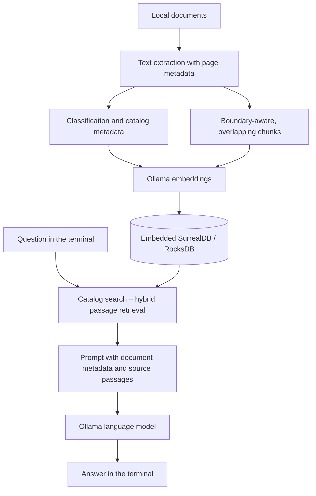

# Svarog

**A local-first AI assistant that turns documents into a searchable knowledge base, right in the terminal.**

Svarog is a Rust application for asking questions about your own reference material, project files, and notes. It combines local language models with **retrieval-augmented generation (RAG)**: finding relevant source material before asking the model to answer.

The project implements the full document-to-answer pipeline: text extraction, document classification, metadata generation, chunking, embeddings, hybrid search, and a keyboard-driven terminal interface.

**Status:** Early-stage prototype, version 0.1.0. Built for local, single-user use rather than production deployment.

[Features](#features) · [Architecture](#architecture) · [Getting started](#getting-started) · [Code guide](#code-guide) · [Limitations](#current-limitations)

## Features

- **Ask questions about local documents.** Import text-based PDFs, Markdown, Rust source, configuration files, and other supported text formats.
- **Search by meaning and keywords.** Combine embedding similarity with BM25 full-text search, then merge the results using Reciprocal Rank Fusion (RRF).
- **Build a document catalog automatically.** Generate titles, summaries, topics, identifiers, and entities, and classify documents as factual, project, or personal knowledge.
- **Keep source context visible.** Retrieved passages carry document titles and physical page numbers. The logs view exposes retrieved context and ranking scores; the answer prompt asks the model to cite sources when useful.
- **Reuse previously ingested knowledge.** Store the catalog, passages, embeddings, and ingestion hashes in an embedded database. Unchanged files skip classification and re-embedding on subsequent ingestion runs.
- **Run with local models.** Ollama handles both text generation and embeddings. With a local Ollama endpoint and locally downloaded models, document processing does not require a hosted AI service or an API key.

### Example workflow

Add a technical manual and some project notes to the input directory, ingest them, then ask:

> What documents do you have about this component?
>
> According to the manual, what are the operating limits?
>
> What does the project documentation say about the storage design?

These are example prompts, not recorded results. Answer quality depends on the documents, retrieval results, and selected model.

## Architecture



### Engineering decisions

| Decision | Implementation and rationale |
| --- | --- |
| Separate document identity from evidence | The catalog describes what a document is about; chunks contain its source text. The grounded prompt explicitly distinguishes generated metadata from evidence for technical claims. |
| Fuse semantic and lexical retrieval | Vector and full-text searches run concurrently, returning up to 24 candidates each. RRF merges and deduplicates their rankings without requiring raw similarity and BM25 scores to share a scale. |
| Preserve source provenance | Text is chunked within each page, preferring paragraph, line, sentence, and word boundaries. Overlap carries nearby context, while document and page metadata remain attached to each chunk. |
| Avoid unnecessary model calls | SHA-256 content hashes combined with an ingestion-version marker identify unchanged sources. Deterministic document and chunk IDs support replacing a document's stored passages on re-ingestion. |
| Separate the UI from backend work | Typed requests and responses travel over Tokio channels. A separate task handles chat and ingestion, and CPU-bound PDF extraction runs on a blocking worker rather than the async executor. |
| Handle imperfect model output | Metadata parsing tolerates surrounding commentary or Markdown fences. Invalid metadata falls back to a source-derived title; classification failures fall back to factual knowledge. |

For each question, the chat service supplies up to **three catalog matches** and **six source passages** to the model. If neither search yields context, it sends the original question without document augmentation.

### Technology stack

| Area | Technology |
| --- | --- |
| Language | Rust, 2024 edition |
| Async runtime and messaging | Tokio, Tokio channels |
| Terminal interface | Ratatui, Crossterm |
| Model integration | Rig, Ollama |
| Persistence and search | Embedded SurrealDB with RocksDB, cosine similarity, BM25 |
| Document processing | pdf-extract, custom text chunking |
| Serialization and change detection | Serde, serde_json, SHA-256 |
| Configuration and errors | dotenvy, color-eyre |

Dependency versions are defined in [Cargo.toml](Cargo.toml).

## Getting started

### 1. Prerequisites

- A recent stable [Rust toolchain and Cargo](https://rustup.rs/) supporting the 2024 edition.
- [Ollama](https://ollama.com/) installed locally, with enough memory for your chosen generation and embedding models.
- Native build tools for the embedded database dependencies. Depending on your platform, these may include a C/C++ compiler, CMake, and Clang/libclang. On Windows, use the MSVC toolchain with Visual Studio's **Desktop development with C++** build tools.

Clone this repository and open a terminal in its root directory. The first build can take a while because it includes native dependencies. No separate SurrealDB server is needed.

### 2. Prepare Ollama

Start the Ollama application. If it is not already serving locally, run this in a separate terminal:

```sh
ollama serve
```

Download a generation model and an embedding model. For example:

```sh
ollama pull llama3.2:3b
ollama pull nomic-embed-text
```

These are example model choices, not a benchmarked configuration. Other Ollama-compatible models can be selected through the environment settings below. Model downloads require internet access; subsequent inference can run locally.

### 3. Configure the application

Create a local dotenv file in the repository root with the following contents:

```dotenv
# Save as .env; keep this local configuration out of version control.
OLLAMA_BASE_MODEL=llama3.2:3b
OLLAMA_EMBEDDING_MODEL=nomic-embed-text
BASE_MODEL_PREAMBLE="You are a helpful assistant. Use supplied sources for document questions and clearly state when evidence is insufficient."
```

The generation model is also used for classification and catalog metadata extraction. The embedding model is used for both stored documents and search queries.

**The dotenv file is required at startup**, even if these variables are already set in the shell. Keep Ollama running while using Svarog.

Optional generation settings:

| Variable | Default | Purpose |
| --- | --- | --- |
| `TEMPERATURE` | `0.7` | Chat generation temperature; classification and metadata agents use `0.0`. |
| `TOP_P` | `0.95` | Nucleus sampling parameter. |
| `TOP_K` | `40` | Token sampling limit, not the number of retrieved passages. |
| `REPEAT_PENALTY` | `1.0` | Repetition penalty. |
| `NUM_CTX` | `8192` | Requested model context-window size. |

### 4. Run and ingest documents

Create the local input directory and place supported files directly inside it. The application uses paths relative to its working directory:

```text
svarog/
├── .env                 # Local configuration
├── input/               # Documents to ingest; create this after cloning
└── svarog_vectors.db/   # Embedded database, created by the application
```

From the repository root:

```sh
cargo run
```

1. Press **i** to ingest the input directory.
2. Press **l** to inspect ingestion progress and retrieval logs; **Esc** returns to the chat view.
3. After ingestion finishes, press **e**, type a question, and press **Enter**.
4. Press **Esc** to leave editing mode, then **q** to quit.

Ingestion is manually triggered and scans only the top level of the input directory. Knowledge persists across restarts; the displayed chat and logs do not.

### Supported input formats

| Content | Extensions |
| --- | --- |
| Text-extractable PDFs | `.pdf` |
| Plain text and documentation | `.txt`, `.md`, `.markdown`, `.rst`, `.adoc` |
| Structured text and configuration | `.json`, `.toml`, `.yaml`, `.yml`, `.csv` |
| Rust source | `.rs` |

Non-PDF files must be valid UTF-8. Scanned PDFs require OCR before ingestion; Svarog does not currently perform OCR.

### Keyboard controls

| Mode | Key | Action |
| --- | --- | --- |
| Normal | **e** | Enter editing mode. |
| Normal | **i** | Start document ingestion. |
| Normal | **l** | Open the logs view. |
| Normal / Logs | **j** / **k** or **↓** / **↑** | Scroll down / up. |
| Normal / Logs | **q** | Quit. |
| Editing | **Enter** | Submit a question when ingestion is not active. |
| Editing | **←** / **→**, **Home** / **End** | Move the input cursor. |
| Editing | **Backspace** | Delete the preceding character. |
| Editing / Logs | **Esc** | Return to normal mode. |

## Code guide

Start with these modules to explore the implementation:

| Entry point | Responsibility |
| --- | --- |
| [src/main.rs](src/main.rs) | Configuration, service initialization, and terminal lifecycle. |
| [src/events.rs](src/events.rs) | Typed requests, responses, and channels between UI and backend. |
| [src/tui/app.rs](src/tui/app.rs) | Application state, input editing, scrolling, and response handling. |
| [src/rig/request_handler.rs](src/rig/request_handler.rs) | Async request dispatch for chat and ingestion. |
| [src/rig/ingestion_service.rs](src/rig/ingestion_service.rs) | Incremental ingestion, classification, and metadata extraction. |
| [src/rig/chunking.rs](src/rig/chunking.rs) | Recursive text splitting and overlapping context. |
| [src/rig/retrieval.rs](src/rig/retrieval.rs) | Concurrent retrieval and Reciprocal Rank Fusion. |
| [src/rig/chat_service.rs](src/rig/chat_service.rs) | Context selection, grounded prompt construction, and model calls. |
| [src/rig/knowledge/mod.rs](src/rig/knowledge/mod.rs) | Persistence facade, backed by separate schema, catalog, chunk, and hash modules. |

### Tests

Unit tests cover chunking, page metadata, unchanged-source detection, rank fusion and deduplication, and empty-context prompt construction.

The [chunking tests](src/rig/chunking.rs#L111) require a local text fixture at the path shown below. The input directory is gitignored, so ensure the fixture exists before running tests in a fresh clone. Use non-empty UTF-8 text, preferably several paragraphs:

```text
input/example.txt
```

```sh
cargo test
```

These tests exercise local logic; they are not an end-to-end evaluation of model answers or retrieval quality.

## Current limitations

- **Prototype scope.** There is no web interface, multi-user API, or persistent conversation history. Responses are displayed when complete rather than streamed token by token.
- **Sequential backend requests.** Chat and ingestion share one request handler. The UI remains separate, but chat generation does not run concurrently with ingestion.
- **Manual knowledge maintenance.** There is no recursive directory scan or file watcher. Removing a source file does not automatically remove its stored knowledge. Changing embedding models requires rebuilding the stored embeddings; changing the model setting alone does not invalidate ingestion hashes.
- **Model-dependent output.** Catalog metadata and citations are generated by the model and can be wrong. Page references use physical PDF page positions, which may differ from printed page numbers. Retrieval scores are rankings, not confidence estimates.
- **No scaling claims.** Vector retrieval currently calculates cosine similarity over stored candidates rather than using an approximate-nearest-neighbor index. Large-corpus performance and answer quality have not been benchmarked here.
- **Local-first is configuration-dependent.** Documents and embeddings are stored on disk, and document content is sent to the configured Ollama endpoint. Use a local endpoint and local models when handling private material.
